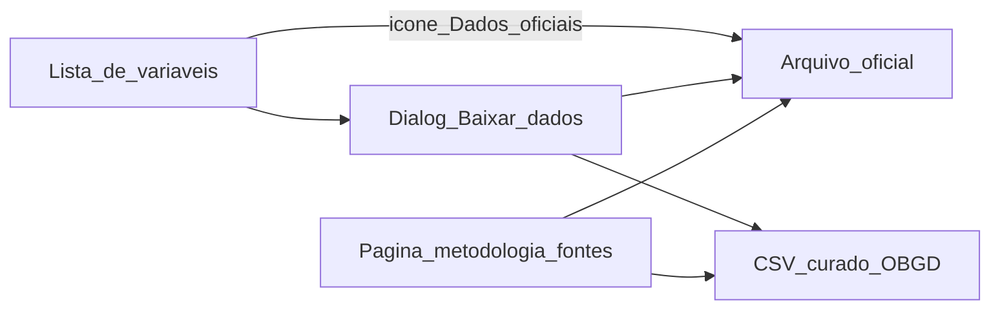
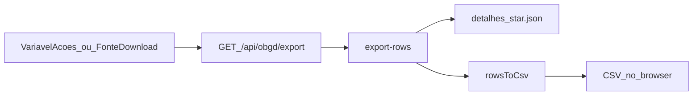

# Fontes oficiais e exportação CSV

| Metadado | Valor |
| --- | --- |
| **Audiência** | Engenharia |
| **Status** | Canônico |
| **Última atualização** | 2026-10-18 |
| **Relacionados** | [Pipeline OBGD](pipeline-obgd.md) · [Disclaimer de variáveis](disclaimer-variaveis.md) · [Índice](../README.md) |

A plataforma **não hospeda** microdados brutos. Oferece dois canais distintos de acesso a dados.

| Canal | Onde | Conteúdo |
| --- | --- | --- |
| **CSV do OBGD** | `GET /api/obgd/export` | Recorte normalizado (0–100) do snapshot usado no índice |
| **Link oficial** | catálogo `FONTES_ACESSO` | Arquivo da edição usada no índice (zip, xlsx, PDF ou API) |



---

## 1. CSV curado do OBGD

### Visão geral

| Aspecto | Decisão |
| --- | --- |
| Geração | Server-side (Route Handler) |
| Origem | `detalhes_{nacional,estadual,municipios}.json` |
| Formato | UTF-8 + BOM, separador `,`, Excel-friendly |
| Schema | Colunas fixas (sem seletor na UI) |



### Arquivos-chave

| Papel | Caminho |
| --- | --- |
| Rota API | `src/app/api/obgd/export/route.ts` |
| Filtro / mapeamento | `src/data/obgd/export-rows.ts` |
| Serializer | `src/lib/export-obgd-csv.ts` |
| UI variável | `src/components/shared/variavel-acoes.tsx` |
| UI fonte | `src/components/metodologia/obgd-fonte-download-button.tsx` |

### Modos de export

| Query | Escopo | Exemplo |
| --- | --- | --- |
| `nivel` + `conceptId` (+ `subItens` opcional) | Indicador em todas as unidades do nível | `/api/obgd/export?nivel=estadual&conceptId=tic_gov/B1` |
| `fonteId` | Indicadores de uma pesquisa OBGD, nos níveis cobertos | `/api/obgd/export?fonteId=munic` |
| `metodologiaSlug` (legado) | Agregado por órgão (várias pesquisas) | `/api/obgd/export?metodologiaSlug=cetic-br` |

Erros comuns: `400` parâmetros inválidos; `404` sem linhas ou fonte sem mapeamento.

### Schema do CSV

Colunas (ordem fixa):

`nivel`, `unidade`, `unidade_nome`, `objetivo`, `objetivo_nome`, `concept_id`, `fonte_id`, `fonte_nome`, `indicador`, `sub_itens`, `descricao`, `escala`, `populacao`, `valor_normalizado`, `ano_fonte`, `ano_indice`

### Nomenclatura dos arquivos

| Modo | Padrão | Exemplo |
| --- | --- | --- |
| Por conceito | `obgd-{nivel}-{slug-concept}.csv` | `obgd-estadual-tic-gov-b1.csv` |
| Por fonte | `obgd-fonte-{slug-id}.csv` | `obgd-fonte-tic-gov.csv` |

### Status

Implementação (API + UI + serializer) concluída. Validação formal do schema com a frente de dados permanece pendente.

---

## 2. Links oficiais das fontes

### Modelo

Tudo vive em [`src/data/obgd/fonte-urls.ts`](../../src/data/obgd/fonte-urls.ts). Não duplicar URLs em outro arquivo.

```ts
type FonteAcessoTipo = 'download_livre' | 'solicitacao' | 'painel'

type FonteArquivoFormato = 'ZIP' | 'XLSX' | 'PDF' | 'TXT'

type FonteArquivo = {
  label: string
  url: string
  tipo: FonteAcessoTipo
  formato: FonteArquivoFormato
  tamanho: string // aproximado, ex.: "1,2 MB"
}

type FonteAcesso = {
  urlPesquisa: string
  arquivos: FonteArquivo[]
}
```

| Campo | Uso |
| --- | --- |
| `urlPesquisa` | Página da pesquisa ou da edição. Nunca a página inicial do órgão. |
| `arquivos[]` | Downloads da **edição usada no índice**: só arquivos que o pipeline usa para calcular o índice |
| `tipo` | `download_livre` · `painel` · `solicitacao` |
| `formato` / `tamanho` | Exibidos junto do tipo ("Download livre · ZIP · 1,2 MB"), para o visitante saber o que vai baixar |

Helpers: `arquivosDaFonte`, `acessoDaFonte`, `urlFontePrimaria`, `descricaoArquivo`, alias `FONTE_URLS`.

O site do órgão (`urlOrgao`) fica em `src/data/fontes.ts` (`ORGAO_URL_POR_INSTITUICAO`), por instituição, fora deste catálogo.

### Regras

1. **Só as fontes usadas no índice têm página.** `/metodologia/fontes/[fonte]` existe para cada fonte com pelo menos um indicador `ativo` em `assets/dados/indicador.json`. Fonte retirada, ou com todas as variáveis excluídas, não tem página, mesmo que `fonte.json` a liste. Se uma variável dela voltar ao índice, a página volta sem mudança de código.
2. **Toda página mostra os dois botões**, "Acessar página da pesquisa" e "Site do órgão". Os dois endereços precisam existir e ser diferentes. Se não forem, o `npm run build` falha e cita a fonte (checagem em `src/data/fontes.ts`).
3. **Downloads só do que o índice usa.** Arquivo que a fonte publica mas o pipeline não usa (exemplo: o ZIP de banda larga fixa da ANATEL) não entra.
4. **Cada link é testado com requisição real** antes do merge. Bloqueio anti-robô (Cloudflare no IBGE, F5 no TCU) ou queda de conexão é registrado como "não verificado", nunca como link quebrado, e o link é conferido no navegador.

### Onde aparece na UI

| Superfície | Comportamento |
| --- | --- |
| Lista de variáveis (`VariavelAcoes`) | Ícone externo → arquivo primário; diálogo com CSV OBGD **e** lista oficial (com formato e tamanho) |
| Página `/metodologia/fontes/[fonte]` | Bloco "Baixar dados oficiais" (com formato e tamanho), os dois botões e o CSV OBGD se houver export |

### Catálogo desta edição (resumo)

IDs = `fonte.id` em `fonte.json`. URLs canônicas só em `FONTES_ACESSO`. Links conferidos e tamanhos medidos em 18/10/2026.

| `fonteId` | Edição | Página da pesquisa | Downloads |
| --- | ---: | --- | --- |
| `tic_gov` | 2023 | CETIC, pesquisa TIC Governo | 2 ZIPs de tabelas ODS (órgãos; prefeituras) |
| `tic_saude` / `tic_educacao` | 2024 | CETIC, página de cada pesquisa | ZIPs de tabelas ODS (Educação: escolas e professores) |
| `iesgo` | 2024 | `iesgo.tcu.gov.br/iesgo2024/` | Tabela dinâmica (XLSX) |
| `iospd` | 2025 | ABEP-TIC, Índice ABEP 2025 | Planilha por dimensões (XLSX) e relatório (PDF) |
| `anatel` | 2025 | Painel "Cobertura Móvel" da ANATEL | `cobertura_movel.zip`, o arquivo atual da ANATEL (o índice usa dezembro de 2025) |
| `censo_escolar` | 2024 | INEP, Censo Escolar | Microdados (ZIP) |
| `pnad_tic` | 2024 | IBGE, PNAD Contínua | Microdados (ZIP) e sintaxe de leitura (TXT) |
| `munic` / `estadic` | 2024 | IBGE, páginas 10586 e 16770 | Bases (XLSX) |
| `igovsisp` | 2025 | Governo Digital, autodiagnóstico iGovSISP | Relatório 2025 (PDF) |

Sem página, por não terem indicador ativo: `tic_cultura` e `tic_domicilios` (mantêm a entrada em `fonte-urls.ts`, com os links conferidos, caso voltem ao índice) e `sgd_sat` (Painel de Satisfação Gov.br, retirado do índice em 08/05/2026; sem entrada).

CETIC: rotular como “Tabelas ODS”, não como microdados unitários (Termo NIC.br).

### Como atualizar (edição seguinte)

1. Obter da frente de dados, por fonte: `fonteId`, ano, URL, `tipo`.
2. Editar só `fonte-urls.ts` (e `ORGAO_URL_POR_INSTITUICAO`, se mudar o órgão).
3. Ajustar `label` com o ano da edição.
4. Medir o tamanho de cada arquivo novo (por exemplo, `curl -s -o NUL -r 0-0 -w "%header{content-range}" <url>`; o total vem depois da barra) e preencher `formato` e `tamanho`.
5. Testar cada link (regra 4) e rodar `npm run build`, que confere a regra 2.
6. Não commitar cópia das bases oficiais no repositório.
