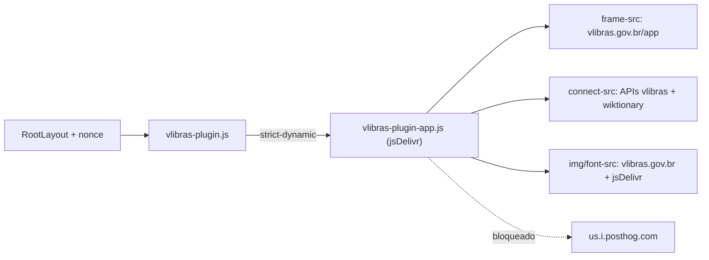

# Acessibilidade em Libras — VLibras Widget

| Metadado | Valor |
| --- | --- |
| **Audiência** | Engenharia · Operação |
| **Status** | Canônico |
| **Última atualização** | 2026-11-10 |
| **Versão validada** | VLibras Widget 7.12.2 |
| **Documentação oficial** | [Integrando a uma página web](https://vlibras.gov.br/doc/widget/installation/webpageintegration.html) |
| **Relacionados** | [Segurança (headers)](../05-operacao/seguranca-headers.md) · [Deploy](../05-operacao/deploy-e-hospedagem.md) · [Índice](../README.md) |

Este arquivo é a fonte de verdade da integração. Ler a seção 4 (CSP) antes de mexer no widget ou nas origens liberadas.

---

## 1. Visão geral

O [VLibras](https://vlibras.gov.br) é a suíte oficial do Governo Federal que traduz conteúdo em português para a Língua Brasileira de Sinais (Libras) com um avatar 3D. O Observatório usa o **widget oficial**, carregado do domínio `vlibras.gov.br`.

- Aparece em **todas as páginas** (root layout), inclusive na variante `/v2`.
- Botão flutuante no meio da lateral **direita** (padrão do widget). Não colide com o Toaster (`bottom-right`).
- Avatar padrão (Ícaro); o usuário pode trocar dentro do widget.
- A preferência "widget aberto" fica no `localStorage` do visitante (chave `@vlibras-widget`), gerida pelo próprio widget.

## 2. Arquivos

| Arquivo | Papel |
| --- | --- |
| [`src/components/layout/vlibras-widget.tsx`](../../src/components/layout/vlibras-widget.tsx) | Server Component: lê `x-nonce` e carrega o plugin com `next/script` (`lazyOnload`) |
| [`src/app/layout.tsx`](../../src/app/layout.tsx) | Renderiza `<VLibrasWidget />` no fim do `<body>` |
| [`src/lib/security-headers.ts`](../../src/lib/security-headers.ts) | Constantes `VLIBRAS_*` e inclusão das origens em `buildCsp()` |
| [`src/app/globals.css`](../../src/app/globals.css) | Variáveis `--vlibras-btn-*` (foco do botão) com tokens do design system |

## 3. Como o widget carrega

1. `https://vlibras.gov.br/app/vlibras-plugin.js` (≈2 KB, com nonce) cria o botão num **shadow root** e se inicializa sozinho. Não há `new VLibras.Widget()` nem markup `<div vw>` (padrão das versões 5/6).
2. No clique, o plugin insere `vlibras-plugin-app.js` como `type="module"`. Os assets de `vlibras.gov.br/app/...` redirecionam (302) para `https://cdn.jsdelivr.net/gh/spbgovbr-vlibras/vlibras-portal@<versão>/app/...`.
3. O app faz um `fetch HEAD` em `vlibras.gov.br/app/unity/index.html` e monta esse endereço num **iframe**: o player Unity/WebGL (WebAssembly) roda no contexto do iframe, em outra origem.
4. Traduções, dicionário e feedback vão para as APIs `*.vlibras.gov.br`; a aba dicionário também consulta `pt.wiktionary.org`.



## 4. CSP

Origens liberadas **globalmente** em `buildCsp()`:

| Diretiva | Origens | Motivo |
| --- | --- | --- |
| `script-src` | **nenhuma** (continua nonce + `'strict-dynamic'`) | O plugin entra com nonce; `'strict-dynamic'` propaga a confiança aos módulos que ele insere |
| `img-src` | `https://vlibras.gov.br` · `https://cdn.jsdelivr.net/gh/spbgovbr-vlibras/` | Ícone e popup do botão, avatares |
| `font-src` | idem | Fonte Rawline (via `FontFace`) |
| `connect-src` | idem + `https://traducao2.vlibras.gov.br` · `https://dicionario2.vlibras.gov.br` · `https://repositorio.vlibras.gov.br` · `https://pt.wiktionary.org` | Checagem do iframe, tradução, dicionário, feedback, aba dicionário |
| `frame-src` | `https://vlibras.gov.br/app/` | Player Unity. Em `/contato`, somam-se as origens do reCAPTCHA |

Notas:

- **Sem `'wasm-unsafe-eval'` / `'unsafe-eval'`**: o WebAssembly roda dentro do iframe, que tem a própria política.
- O jsDelivr é restrito ao caminho `/gh/spbgovbr-vlibras/`. Depois de um redirect, o CSP compara só o host (regra da especificação para não vazar caminhos). O limite de caminho vale para requisições diretas.
- **PostHog bloqueada (decisão de produto)**: o widget importa `posthog-js` do jsDelivr e tenta enviar telemetria para `https://us.i.posthog.com` (só fora de localhost). Essa origem **não** entra no `connect-src`. O `import()` em si não é bloqueado (`'strict-dynamic'`), mas o envio é. Em produção/preview é **esperado** um aviso de CSP no console citando `us.i.posthog.com`; o widget funciona normalmente.
- O iframe vazio (`about:blank`) que o widget cria para checar `String.prototype` não depende de `frame-src`.

## 5. Decisões de implementação

| Decisão | Por quê | Não fazer |
| --- | --- | --- |
| Script oficial do `vlibras.gov.br`, sem versão fixa | O governo publica correções e atualizações no próprio domínio | Hospedar cópia local via `rootPath` (a doc oficial avisa que corta atualizações e correções) |
| `next/script` com `x-nonce` | Mesmo padrão do reCAPTCHA em `/contato`; mantém `script-src` sem host nem `'unsafe-inline'` | Usar wrapper npm (`react-vlibras` e similares), que injeta `<script>` sem nonce |
| `strategy="lazyOnload"` | Não compete com hidratação nem LCP; o script não aparece no HTML inicial | `beforeInteractive` |
| Sem script inline de configuração | Os padrões (posição `R`, avatar Ícaro) atendem; evita outro script para carimbar | `new window.VLibras.Widget({...})` inline sem nonce |
| Sem SRI | O plugin muda sem aviso e o SRI não cobre os módulos filhos | Fixar `integrity` no plugin (quebra a cada atualização) |

**Risco aceito:** o código do widget roda na origem do Observatório. Um comprometimento de `vlibras.gov.br` ou do repositório `spbgovbr-vlibras/vlibras-portal` afetaria o portal. É o mesmo modelo de confiança dos sites gov.br que usam o widget.

**Privacidade:** toda página baixa o plugin e as imagens do botão (o jsDelivr vê o IP do visitante). O texto enviado para tradução vai para `traducao2.vlibras.gov.br` apenas quando o visitante usa o widget.

## 6. Personalização visual

O botão vive num shadow root; só as variáveis oficiais atravessam. Definidas em `:root` com tokens:

```css
--vlibras-btn-focus-visible-outline: 2px solid var(--background);
--vlibras-btn-focus-visible-shadow: 0 0 0 4px var(--ring);
```

Também existem `--vlibras-btn-outline` e `--vlibras-btn-hover-filter` (não usadas). Não use cores literais.

## 7. Atualização de versão do VLibras

O widget atualiza sozinho. Quando o comportamento mudar (ou periodicamente):

1. `curl -sL https://vlibras.gov.br/app/vlibras-plugin.js` e veja a versão em `vlibras-plugin-app.js?v=…`.
2. `curl -sIL "https://vlibras.gov.br/app/vlibras-plugin-app.js?v=<versão>"` para seguir o redirect até o jsDelivr.
3. Baixe o chunk `vlibras-initial-*.js` importado e liste as origens: `grep -oE "https?://[a-zA-Z0-9._/-]+" vlibras-initial-*.js | sort -u`. Ignore os hosts `*-dth` (homologação do próprio VLibras).
4. Origem nova → incluir na constante `VLIBRAS_*` correspondente e atualizar a tabela da seção 4 e a "Versão validada" do cabeçalho.

## 8. Troubleshooting

| Sintoma | Causa provável | Ação |
| --- | --- | --- |
| Botão não aparece | Script bloqueado (sem nonce) ou `vlibras.gov.br` fora do ar | Conferir `nonce` no `<script>` gerado; testar a URL do plugin |
| Botão sem ícone | `img-src` sem a origem (ou redirect para host novo) | Ver violação no console; ajustar `VLIBRAS_ASSET_SRC` |
| Painel abre mas avatar não carrega | `frame-src` sem `vlibras.gov.br/app/` ou player indisponível | Console; o widget tenta de novo sozinho (até 5 vezes) |
| Tradução não acontece | `connect-src` sem a API de tradução | Ver host bloqueado no console; seguir a seção 7 |
| Aviso de CSP com `us.i.posthog.com` | Telemetria bloqueada de propósito | Nenhuma |

## 9. Checklist de teste

1. `npm run build && npm start`; `curl -sI http://localhost:3000` e `curl -sI http://localhost:3000/contato`: `frame-src` com VLibras nas duas, reCAPTCHA só em `/contato`.
2. Home, ranking, metodologia e contato: botão visível à direita; clique abre o avatar; selecionar um texto e traduzir; abrir a aba dicionário.
3. Teclado: Tab chega ao botão e o foco usa o anel `--ring`.
4. Console sem violações de CSP (exceto PostHog fora de localhost).
5. Após o deploy: Rescan no [MDN Observatory](https://developer.mozilla.org/en-US/observatory/).
